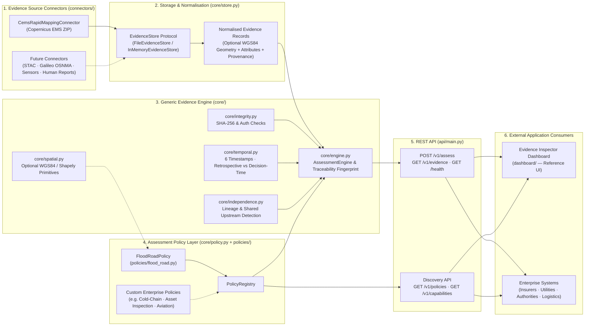

# EIP v0.2 Architecture

The **Evidence Integrity Platform (EIP)** is domain-independent enterprise infrastructure for deterministic, auditable assessment of structured claims against external evidence. Flood-road passability (`flood-road-0.1`) is one pluggable domain policy — not the platform itself.

---

## 1. Architectural Diagram

---

## 2. Explicit Layer Interfaces

| Layer | Module(s) | Explicit Interface | Responsibility |
|---|---|---|---|
| **Evidence Source Connectors** | `connectors/base.py`, `connectors/cems_rapid_mapping.py` | `EvidenceConnector` protocol (`metadata`, `load_evidence()`) | Ingest provider artefacts, compute raw SHA-256, validate and normalise into `Evidence` with honest `provenance` and `available_at`. |
| **Storage & Normalisation** | `core/store.py` | `EvidenceStore` protocol (`load_all() -> list[Evidence]`) | Validate schema invariants, enforce unique IDs, isolate storage backend (`FileEvidenceStore`, `InMemoryEvidenceStore`, or future SQL/object stores). |
| **Generic Evidence Engine** | `core/engine.py`, `core/temporal.py`, `core/integrity.py`, `core/independence.py`, `core/spatial.py`, `core/models.py` | `AssessmentEngine(registry).assess(claim, evidence, assessed_at)` | Domain-independent preprocessing: policy dispatch, auth exclusion, retrospective vs decision-time gating, source independence analysis, deterministic SHA-256 `input_fingerprint`, cross-cutting limitations. **Contains zero domain rules.** |
| **Assessment Policies** | `core/policy.py`, `policies/flood_road.py` | `AssessmentPolicy` protocol + `PolicyRegistry` | Encapsulate domain claim validation, relevance filtering, per-evidence evaluation rules/thresholds, aggregation, reason explanations, and domain limitations. |
| **REST API** | `api/main.py` | `create_app(evidence_path, registry, store)` | Expose Contract `v0.1`/`v0.2` assessment, evidence, health, and capability/policy discovery endpoints over HTTP/JSON with OpenAPI. |
| **Application Consumers** | `dashboard/` or external clients | HTTP/JSON per `CONTRACT.md` | Submit structured claims, discover registered policies, inspect visual/provenance evidence, and present non-oracle outcomes. |

---

## 3. Core Architectural Guarantees

### 3.1 Domain Independence & Non-Geographical Support
- `core/engine.py` and its supporting modules (`models.py`, `policy.py`, `temporal.py`, `integrity.py`, `independence.py`, `spatial.py`, `store.py`) contain **no** flood-road rules, thresholds, or imports from `policies/`.
- Both `Evidence.geometry` and `ClaimRequest.geometry` are optional (`None` allowed). Non-geographical domains store structured measurements and claim parameters in `attributes: dict[str, Any]`.
- No LLM and no arbitrary numerical "truth probability" score exist anywhere in the platform.

### 3.2 Temporal Integrity (Retrospective vs Decision-Time)
Six distinct UTC timestamps are modelled:
1. `observed_at` (when the event/measurement occurred)
2. `available_at` (when the evidence was published / became available to decision-makers)
3. `retrieved_at` (when EIP retrieved the artefact)
4. `claimed_at` (when the claimed state pertains to)
5. `decision_time` (the decision timestamp under audit in `decision_time` mode)
6. `assessed_at` (when EIP executed the assessment; echoed in `traceability.assessed_at` when caller-supplied and emitted in `X-EIP-Assessed-At` HTTP header)

In **`decision_time`** mode, `core/temporal.py` enforces that:
- Observations with `observed_at > decision_time` are rejected (`NOT_AVAILABLE_AT_DECISION_TIME`).
- Evidence with `available_at > decision_time` is rejected (`NOT_AVAILABLE_AT_DECISION_TIME`), preventing post-decision publications from leaking into decision-time audits.
- Evidence with `available_at == null` is rejected (`AVAILABILITY_TIME_UNKNOWN`) and recorded in `temporal_context.unknown_availability_ids` with explicit uncertainty limitations.

In **`retrospective`** mode (default), historical replay preserves full v0.1 behaviour.

### 3.3 Source Independence & Shared Upstream Dependencies
`core/independence.py` inspects `Evidence.provenance` (`original_source`, `publishing_organisation`, `upstream_datasets`, `derived_from`, `measurement_method`, `shared_dependencies`) plus `product_id`:
- Uses connected-component grouping (union-find) so derived products sharing an upstream dataset, original sensor, lineage link, or declared dependency collapse into a single correlated group (`status: "shared_dependencies_detected"`).
- If any item in a multi-source set omits provenance metadata, independence remains explicitly `"unknown"` (`independent_group_count: null`).

### 3.4 Prepared Connector Architecture
`connectors/base.py` defines `EvidenceConnector` and `ConnectorMetadata` so future connectors — including Copernicus Data Space STAC, Galileo OSNMA receiver logs (populating `authentication="verified"` only with documented cryptographic verification), terrestrial IoT/gauge sensors, and structured human reports — can be added without modifying `core/` or `api/`.

---

## 4. How an Independent Enterprise Extends EIP

An enterprise (insurer, utility, logistics operator, or public authority) extends EIP through composition — without forking or editing `core/`:

1. **Add a Source Connector:** Implement `EvidenceConnector` in a new module to normalise internal or external data feeds into `Evidence` records (populating `available_at`, `provenance`, `sha256`, and `attributes`).
2. **Add a Domain Policy:** Implement `AssessmentPolicy` (see `docs/POLICY-DEVELOPMENT.md`) defining `spec`, `validate_claim`, `is_evidence_relevant`, `evaluate_evidence`, and `aggregate`.
3. **Wire at Application Startup:** Register custom policies into a `PolicyRegistry` and pass `(registry=..., store=...)` into `api.main.create_app(...)` (or embed `AssessmentEngine(registry)` directly in Python batch workflows).
4. **Discover Dynamically:** Consumers query `GET /v1/capabilities` and `GET /v1/policies` to discover newly registered claim types, evidence kinds, thresholds, and reason explanations automatically.
