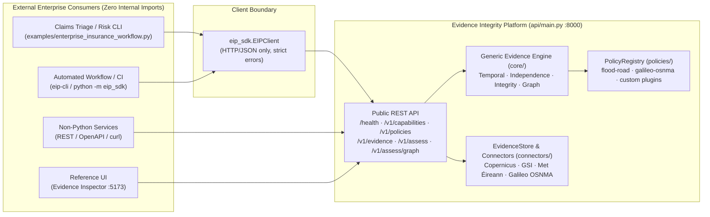

# EIP Enterprise Integration, Extension & Standards Guide (v0.6.0)

This document describes how external applications consume EIP as reusable infrastructure, how engineering teams extend EIP with new evidence connectors and domain policies without modifying `core/` or `eip_sdk/`, and how EIP's data model compares against OpenAPI, GeoJSON, STAC, and W3C PROV.

---

## 1. Enterprise Integration Architecture

External applications consume EIP strictly across the public REST API boundary (directly via HTTP or through `eip_sdk`). **Evidence Inspector** is a reference UI consumer—not the primary product.



---

## 2. End-to-End Extension Process (Zero Changes to `core/` or `eip_sdk/`)

The test-only pharmaceutical cold-chain policy ([tests/fixtures/cold_chain_policy.py](../tests/fixtures/cold_chain_policy.py)) and its live SDK integration test ([tests/sdk/test_v06_sdk_and_integration.py](../tests/sdk/test_v06_sdk_and_integration.py)) verify that an external team can add a new domain in 7 steps without touching the generic engine or client SDK:

### Step 1 — Implement an Evidence Connector
Implement `connectors.base.EvidenceConnector` (`load_evidence() -> list[Evidence]`):
- Preserve raw downloaded/recorded artifacts on disk and compute `sha256` over raw bytes (`core.integrity.sha256_file`).
- Populate `provenance` (`original_source`, `publishing_organisation`, `upstream_datasets`, `derived_from`, `measurement_method`, `shared_dependencies`) honestly.
- Never invent `observed_at`, `available_at`, `coverage`, or `authentication="verified"`.

### Step 2 — Define a New Evidence Kind
`Evidence.kind` is an open non-empty string (e.g. `"temperature_telemetry"`).
- Non-geographical evidence sets `geometry=None` and `coverage=None`, storing structured domain readings in `attributes` (e.g., `{"min_temp_c": 2.4, "max_temp_c": 11.8}`).
- Geographical evidence uses WGS84 GeoJSON (`Point`, `LineString`, `Polygon`, or `MultiPolygon`).

### Step 3 — Implement an Assessment Policy
Implement `core.policy.AssessmentPolicy` (see [docs/POLICY-DEVELOPMENT.md](POLICY-DEVELOPMENT.md) and [tests/fixtures/cold_chain_policy.py](../tests/fixtures/cold_chain_policy.py)):
- Expose `spec: PolicySpec` (claim types, evidence kinds, thresholds, outcomes, reason explanations, and known limitations).
- Implement `validate_claim`, `is_evidence_relevant`, `evaluate_evidence`, and `aggregate`.
- Avoid numerical truth scores, LLM calls, or misleading "safe / certified" verdicts.

### Step 4 — Register the Policy
```python
from policies import build_default_registry
from my_domain.policies.cold_chain import ColdChainPolicy

registry = build_default_registry()
registry.register(ColdChainPolicy(max_age_hours=6.0))
```

### Step 5 — Expose Through the Existing REST API
Pass your registry and `EvidenceStore` into `create_app()`:
```python
from api.main import create_app
from core.store import FileEvidenceStore

app = create_app(
    registry=registry,
    store=FileEvidenceStore("path/to/cold_chain_evidence.json"),
)
```
`/v1/capabilities`, `/v1/policies`, `/v1/assess`, and `/v1/assess/graph` automatically expose the new domain.

### Step 6 — Consume via the Unchanged Python SDK
No SDK modifications are required:
```python
from eip_sdk import ClaimInput, EIPClient

client = EIPClient("http://127.0.0.1:8000")
assert "cold_chain_within_limits" in client.supported_claim_types()

claim = ClaimInput.custom(
    claim_id="shipment-99",
    claim_type="cold_chain_within_limits",
    claimed_at="2025-02-01T11:00:00Z",
    source_label="Synthetic cold-chain claim",
    attributes={"allowed_min_c": 2.0, "allowed_max_c": 8.0},
    synthetic=True,
)
graph_result = client.assess_with_graph(claim)
```

### Step 7 — Test and Validate the Integration
Validate against the full checklist in `docs/POLICY-DEVELOPMENT.md` (determinism, staleness, `decision_time` exclusions, failed auth exclusion, shared upstream grouping, HTTP `422` claim validation, and live HTTP consumption via `EIPClient`).

---

## 3. Standards and Interoperability Review

> **Honesty Statement:** EIP v0.6.0 does **not** claim formal certification or full conformance with OpenAPI, GeoJSON, STAC, or W3C PROV specifications. The review below documents actual current alignment, concrete differences, and pragmatic future interoperability steps.

| Standard | Current Compatibility in EIP v0.6.0 | Concrete Differences / Gaps | Potential Future Improvements |
|---|---|---|---|
| **OpenAPI (3.1)** | FastAPI automatically generates a valid OpenAPI 3.1 schema at `GET /openapi.json` and interactive Swagger UI at `/docs` covering all Pydantic request/response models. | Error envelopes for policy-level `422` (`unsupported_claim_type`, `unknown_policy`, `claim_validation_error`) are raised via `HTTPException` rather than declared as typed OpenAPI `responses` schemas. No `securitySchemes` are declared yet (local unauthenticated service). | Declare explicit `422` error response models in FastAPI route signatures; generate typed OpenAPI clients (TypeScript, Go, Java); add `securitySchemes` when enterprise authN is introduced. |
| **GeoJSON (RFC 7946)** | Spatial `geometry` and `coverage` fields accept standard WGS84 `[lon, lat]` GeoJSON geometry objects (`Point`, `LineString`, `Polygon`, `MultiPolygon`) validated for finite WGS84 bounds and geometric validity via Shapely. | EIP embeds raw geometry objects inside `Evidence` and `ClaimRequest` rather than wrapping every item in a RFC 7946 `Feature` / `FeatureCollection`. Antimeridian splitting and RFC 7946 right-hand-rule ring orientation enforcement are not strictly enforced beyond Shapely validity. | Provide an optional GeoJSON `FeatureCollection` export view (`Accept: application/geo+json`) for GIS consumers; enforce RFC 7946 ring winding on connector normalisation. |
| **STAC (SpatioTemporal Asset Catalog)** | `Evidence` shares core concepts with STAC Items: `id`, `geometry`, `observed_at` (≈ `properties.datetime`), `licence` (≈ `properties.license`), `source_url` / `raw_path` / `sha256` (≈ STAC `assets` + `file:checksum`), and sensor metadata in `attributes`. | EIP is **not** a STAC API: it supports non-spatial domains (`geometry: null`), omits mandatory STAC fields (`stac_version`, `type: "Feature"`, `bbox`, `links`, `assets` map), and separates `available_at` from `observed_at` for decision-time auditing. | Add a STAC connector (`StacItemConnector`) that ingests standard STAC Items/Catalogs into `Evidence`, and an optional STAC Item mapper for spatial evidence exports. |
| **W3C PROV (PROV-DM / PROV-JSON)** | `Evidence.provenance` and `core/graph.py` mirror PROV concepts: `Evidence` ≈ `prov:Entity`, `publishing_organisation` / `original_source` ≈ `prov:Agent`, `derived_from` / `upstream_datasets` ≈ `prov:wasDerivedFrom`, and `AssessmentTraceability` (`input_fingerprint`, `policy_version`, `assessed_at`) ≈ `prov:Activity` generating an assessment entity. | EIP uses a lightweight domain-independent JSON graph (`GraphNode`, `GraphEdge`) tailored to independence grouping and freshness rather than formal PROV-JSON (`entity`, `activity`, `agent`, `wasDerivedFrom`, `wasGeneratedBy`) or PROV-O RDF namespaces. | Add a deterministic exporter mapping `AssessmentGraphResponse` → W3C PROV-JSON for regulatory audit archives and knowledge-graph ingestion. |
